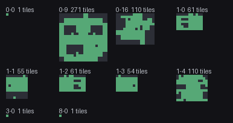
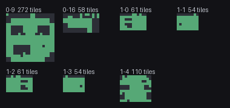

# Pokemon Emerald RL

A reinforcement learning agent that learns to play Pokemon Emerald from pixels, aiming for the first gym badge.

PPO over a Gymnasium environment wrapping mGBA. The agent sees the screen and a small decoded state vector, presses buttons, and is rewarded for exploring Hoenn and making story progress. No scripted routes, no hardcoded paths.

## Exploration spreading over training

Every map the agent has walked, one panel per map, sized to the bounding box of tiles it actually stood on.

| 250k steps | 1.25M steps |
| --- | --- |
|  |  |

Littleroot Town (panel `0-9`) fills in first, then Route 101 (`0-16`), the houses, and Birch's lab (`1-4`) where the starter is obtained. The same image is logged to TensorBoard as `coverage/map`, so it fills in live while training runs.

## What the agent actually achieved

Read any progress savestate with `stats.py`:

```
$ python stats.py
savestate                      where                badges party  seen caught   money
furthest_1maps_0_9.state       Littleroot Town           0     0     0      0    3000
furthest_5maps_0_16.state      Route 101                 0     0     0      0    3000
furthest_6maps_1_4.state       Birch's lab               0     1     2      1    3000

furthest_6maps_1_4.state  at Birch's lab (6, 5)
    mudkip       lv5   20/20 HP
```

It reaches Birch's lab and obtains Mudkip, which requires completing the bag scene, a sequence of dialogue and a scripted battle. No badge yet.

## How it works

**Observation.** Three stacked grayscale frames downscaled to 120x80, plus a
29-value vector. The first 17 are decoded from RAM: badge bits, party HP
fraction, mean party level, map id, player x/y, money, Pokedex seen and caught.

The other 12 describe the agent's own situation: a one-hot of the last action,
whether that action moved it, and how far along each of the three penalty
counters it is. They exist because the penalties were being charged on state
the agent could not perceive. `_frozen_steps`, `_block_steps` and
`_steps_since_reward` lived only in the environment, so "standing at (13,14)
having pressed up 500 times" and "arriving at (13,14)" were the same input, and
only one of them was about to be charged -5. Nor could the agent see which
button it had just pressed, and Gen-3 animates walking on the spot when the way
is blocked, so a step into a wall and a step that moved look alike for several
frames. Each counter is reported as a fraction of the limit that charges it, so
a penalty is visible on the way in rather than arriving as a surprise.

**Actions.** `Discrete(8)` — no-op, up, down, left, right, A, B, start. One button per step, held 23 of 24 frames after a one-frame release. That release matters: Gen-3 gates dialogue, menus and battle moves on a fresh press edge, so a held button reads as a single press no matter how long it is held.

**Vision and text.** `--backbone agent` (the current run) is a NatureCNN over the
screen, a learned text encoder over the on-screen text, and an inverse-dynamics
head. The text encoder is the smallest thing that earns the name "language
model": each word of the 64-character text window is hashed (crc32, stable
across processes) into a 1,024-slot vocabulary and embedded, then mean-pooled
to 32 values, trained end to end by PPO. It lets the policy tell "Got away
safely!" from "Wild ZIGZAGOON appeared!" from a menu, which 120x80 pixels do
not make easy. The inverse-dynamics head predicts which button was pressed
between two consecutive screens, trained on pairs from the rollout buffer after
each PPO update with gradients flowing into the shared CNN. Reward alone had
54 million steps to teach the CNN that a step into a wall and a step that
moved look different, and did not; this supervises exactly that with labels
we already hold. `aux/idm_acc` in TensorBoard is the check: chance is 1/8.

The same features drive a curiosity bonus, which is how vision steers where to
go. A forward model predicts the next screen's features from the current ones
and the action, and the agent is paid `reward/curiosity` where that prediction
fails: a place the screen is doing something it has not seen enough of. Where
the model is right the place is known and the bonus fades on its own. The
error is divided by its running mean so the bonus is about 0.005 per step on
an average screen whatever the feature scale, and capped at five times that so
one strange frame cannot outbid a badge. It is a per-step signal from pixels,
so it reaches places the RAM novelty terms cannot see: a battle going
differently, a new menu, an animation. Known limit: screens that are
unpredictable but useless, like battle animations, also pay (the "noisy TV");
if `reward/curiosity` dominates while `new_tile` stays flat, lower
`CuriosityWrapper.BETA`.

The two older options remain. By default a small CNN trained from scratch (NatureCNN), which is the
standard choice for pixel-based RL. `--backbone resnet18` swaps in a frozen
ImageNet ResNet18 instead, for comparison. Two caveats worth knowing: the three
screen channels are consecutive frames rather than RGB, so ResNet's pretrained
colour filters are being fed temporal structure; and ImageNet is photographs
while Emerald is flat-shaded pixel art. Measured cost is roughly 15% throughput
(266-312 fps against 300-330). Whether it actually helps is an open question the
flag exists to answer.

**Reward.** The badge is roughly 50,000 steps from the start, so a sparse signal cannot bridge the gap. Progress events are combined with a coordinate-novelty bonus:

| Event | Reward |
| --- | --- |
| Gym badge | +100 |
| New map entered | +2 |
| New tile visited | +0.05, capped at 400/map |
| New 8x8 section entered | +0.5, plus +1 the first time ever in the process |
| Script event flag set | +1 |
| Trainer defeated | +2 |
| Experience gained | +0.02 per point (a wild win is 20-40) |
| Party level gained | +1 |
| Party HP fraction | +/-3 per full bar, both directions |
| Running from a battle | -5 |
| Our Pokemon uses a move | +0.2 per message |
| A wild battle starts | +1 per encounter |
| Damage dealt | +0.5 per enemy HP bar, charged back on healing |
| Walking toward the nearest never-visited section | +0.1 per section, potential-based |
| Changing an OPTION setting | -10 |
| Pressing Start | -0.5 |
| Pressing a direction without moving (overworld, no text on screen) | -0.05 |
| Curiosity (forward-model error) | ~+0.005/step, capped at 0.025 |
| Pokemon seen / caught | +0.5 / +5 |
| Whiteout | -5 (does not end the episode) |
| 600 steps earning nothing | -3 |
| 30 moves covering 6 or fewer tiles | -1 |
| 600 steps frozen on one tile | -5 |

Script and trainer flags are credited potential-style against a mark, like the
HP term: a rise above the mark is paid, a fall below it is charged at the same
rate, and the mark follows. A garbage excursion of any length therefore nets
zero once the real value returns, and trainer flags are never cleared in-game
so real play is never charged. On top of that a count must be read identically
three times, on a map that has held still for three steps, before it moves the
mark at all. The
54M-step `nature2` run found a pump without that: standing on Birch's lab door
and warping in and out, each warp's save-block relocation read `trainer 0->7`
on an identical bogus map id for two steps, which passed the stability gate as
settled and paid +14. Over nine days that term booked 301,873 against 23 for
experience, with the party never gaining a point; traced live, 393 such flips
in 12,000 steps for `trainer +472`. Trainer flags are never cleared in-game, so
a new all-time high is the only thing that can be real.

The freeze and stall counters clear on positive income booked that step, not
on the net reward: the symmetric HP term and the loiter charge routinely drag a
productive step to zero or below, so a wild win that cost 20% HP read as
"earned nothing" and the freeze counter kept running through the battle.

The freeze penalty covers what the loiter penalty deliberately exempts.
Loitering is grid-free: the last 30 moves covering 6 or fewer tiles. Two
earlier versions keyed it on a fixed 16x16 then 8x8 block, and the policy found
the loophole in both within a day: step one tile sideways every few steps back
and forth across a block boundary, and the counter resets on every crossing. A
window of recent moves has no boundary to straddle. It only counts steps where
the player moved, so that battles, dialogue and menus are not billed, and that
exemption made walking into a wall free.
Measured on the 300k policy over 5,000 steps: position frozen on 94.7% of them,
the longest single freeze running 1,170 steps against one wall, 53 distinct
tiles touched in total, and an action mix of 28% up, into that wall. The whole
1,170-step freeze cost about -1.4, because the stall penalty charges once per
2,500 steps. 600 steps sits well above a battle (60-150 steps for a wild one, a
few hundred for a trainer) and well below the observed freeze, and earning
anything clears the counter, which exempts a battle outright.

The loiter penalty is what the tile cap alone does not cover. A 16x16 block
holds 256 tiles against a 400-tile per-map cap, so an agent can shuffle around
a single block and draw tile novelty the whole time without going anywhere.
Only steps where the player actually moved are counted: a battle, a dialogue
and an open menu all freeze the position, and billing those would undo the
battle rewards.

Pokedex and level terms are deliberately large. Both are paid against
monotonic counters (popcounts of the dex bit arrays, a high-water mark of the
party level sum), so neither can be farmed by depositing and withdrawing. There
is no separate bonus for a complete dex: 386 species, several of them version
exclusives, against a run that has yet to earn one badge.

The per-map tile cap stops the agent farming reward by pacing across a large
route. Sections are 8x8 tile blocks, sitting between the tile and map terms:
pacing inside one earns nothing after the first step in, so the signal rewards
direction rather than shuffling, and unlike tile novelty it is not exhausted by
the per-map cap.

Bumping is the targeted charge for walking into things. The 400k policy spent
a quarter of its actions pressing up into a blocked tile, and nothing billed it:
loiter and freeze exempt stationary steps so that battles are not taxed. A
direction press that does not move the player costs one new tile's worth, but
only in the overworld with no text on screen, because in a battle, a menu or a
dialogue a direction press moves a cursor and never the player, and the text
reader tells those apart.

Start is taxed per press rather than per step spent in a menu. Sampling the
100k policy every 1,000 steps put 7 of 20 frames in one: the start menu twice,
the party screen twice, the trainer card, an item submenu and a transition, a
third of its life, with a Torchic at 8/25 HP it never healed. Detecting "a menu
is open" would be the direct fix, and three RAM scans failed to turn up a marker
that survived a repeat run, so the entry point is charged instead. Every one of
those screens is reached through that one button, and nothing the badge needs
sits behind it: a Pokemon Center heals by talking to the nurse, and the battle
BAG is reached with A. The button is kept in `ACTIONS` rather than removed, so
the tax is one constant to undo where dropping it would change the action space.
The size is measured rather than guessed: at -2 the first rollout booked -103
per 1,000 steps, which is 51 presses per 1,000 steps and 100x every other term
combined, so it was set to price a press at about ten new tiles instead.

Damage is potential-based on the enemy's HP fraction, read from the battle
Pokemon array: a fall pays, a rise (the enemy healing) charges at the same
rate, and nothing is booked across a battle's start or end, so a new enemy's
full bar is not a loss and a faint pays its final decrease once. A whole bar is
worth about one wild win's experience. It is what makes "win on purpose"
learnable: the agent is told, on the turn it happens, that the move it chose
hurt.

Frontier shaping is potential-based on the Manhattan distance, in 8x8
sections, to the nearest section never visited on the current map. A step
that shortens it pays 0.1, one that lengthens it charges 0.1, so a loop nets
zero and nothing can be farmed. It is deliberately small: when nothing else is
paying it tilts the agent toward the edge of what it knows. It is not a route;
there is no goal in it, only "unexplored is that way".

Nothing but the OPTION screen writes the settings half-word, so a change to it
is proof the agent went in and fiddled, which it had: TEXT SPEED was found set
to SLOW, which multiplies the number of steps every mandatory dialogue costs.
The values are only written back on leaving the screen, so the charge lands on
exit; entering and leaving without touching anything is billed by the stall
penalty instead.

TEXT SPEED is also pinned to FAST outright, written back into SaveBlock2 at
reset and on any step that finds it moved. The penalty alone was not enough:
it is paid once and the slow text then persists for millions of steps. The pin
touches bits 0-2 only, so BATTLE SCENE, BATTLE STYLE, SOUND, BUTTON MODE and
FRAME stay the agent's to set.

The HP term is symmetric on purpose. A one-way heal bonus is farmable: taking
damage would be free and healing at a Pokemon Center is free and unlimited, so
"get hurt, walk back, heal" would pay forever. Charging the damage too makes a
full cycle net zero, and what remains is the useful part, that a hurt party is
worth less than a healthy one, so walking to a Center pays and the Start menu
has a reason to be pressed.

**Episodes** start from the furthest *outdoor* progress savestate the agent has
ever reached, falling back to the post-intro savestate on a fresh clone.
Outdoor matters: the deepest state on disk was the Oldale Pokemon Center
interior, and a measured 6,000-step rollout from it never left that one room,
collecting 3.5 reward in the first moments and then two stall charges for a net
-2.5. The policy learned its routes outdoors and does not know how to walk out
of a building. Map group 0 is Hoenn's towns and routes; every other group is an
interior. With
`--max-steps 0` an episode only ends on a badge, so `reset()` runs about once
per process and every restart was otherwise throwing away 14 maps of progress
and walking out of Littleroot again. Episodes end on a badge
or at the step cap. `--max-steps 0` removes the cap entirely, in which case
only a badge ends an episode and `reset()` never runs. The exploration sets are
therefore refreshed on a fixed 50,000-step schedule rather than only on reset.
Without that they filled once and stayed full: measured over 9 million steps
from 73.1M, `tiles_visited` was frozen at 486, `maps_visited` at 8, and
`new_tile`, `new_section`, `new_map`, `exp`, `hp` and `caught` all reported
exactly 0, leaving reward between -1 and -5.6 per 1,000 steps, all of it stall
penalty. The schedule is fixed rather than triggered by the stall penalty on
purpose: the latter would let the agent stall deliberately to make its old
routes pay again. A whiteout is deliberately not fatal: in this game it warps
the player to a Pokemon Center with a healed party and play continues. Ending
the episode on it discarded all accumulated exploration, and measurement showed
every episode was ending that way at ~18,300 steps against a 65,536 cap.

## Reading whether it is learning

`rollout/ep_rew_mean` is not usable on this run. With `--max-steps 0` an
episode only ends on a badge, so it never updates, and what it does print is an
`ep_info_buffer` restored from the checkpoint: for a long stretch it reported
1.34e6 reward over 6.55e4-step episodes, from a run whose step cap had been
removed weeks earlier.

Watch `reward/*` instead. Every reward line is booked against a named term and
the totals are drained once per rollout, so TensorBoard carries a per-1,000-step
rate for each: `reward/new_tile`, `reward/exp`, `reward/caught`, `reward/loiter`
and so on, plus `reward/total`. It is episode-independent, and a term that
starts farming itself shows up as a curve climbing away from the others.

## Layout

| File | Role |
| --- | --- |
| `state.py` | RAM-only game state reader, kept off ROM for speed |
| `env.py` | Gymnasium environment, observations, reward |
| `train.py` | PPO across 8 subprocess workers |
| `backbone.py` | Optional pretrained ResNet18 feature extractor |
| `extractor.py` | Current extractor: NatureCNN + text encoder + inverse-dynamics head |
| `text.py` | Follows the game's text printer to the exact on-screen string, no OCR |
| `coverage.py` | Renders the exploration overlay |
| `stats.py` | Decodes a savestate into readable progress |
| `baseline.py` | Random-agent exploration gate |
| `watch.py` | Renders a trained checkpoint playing |
| `make_savestate.py` | One-off tool to capture the starting savestate |

## Running it

Needs a legally-dumped Pokemon Emerald ROM at the repo root as `Pokemon - Emerald Version (USA, Europe).gba`. Not included.

```bash
sudo apt install libmgba0.10t64          # the mgba wheel does not bundle libmgba.so
uv venv --python 3.11 .venv              # 3.11 exactly; mgba has no 3.12 wheels
VIRTUAL_ENV=.venv uv pip install pygba pillow stable-baselines3 tensorboard

python make_savestate.py                 # play the intro once, press S
python train.py --steps 50000000
python train.py --steps 50000000 --backbone resnet18   # pretrained vision instead
python train.py --steps 50000000 --batch-size 512      # default is 128
python watch.py checkpoints/emerald_final.zip
python stats.py
tensorboard --logdir runs
```

Measured at ~300-330 env steps/sec across 8 workers on an 8-core laptop.

## Things that cost real time

Recorded because none were obvious and each burned hours:

**`import torch` breaks libmgba.** Any emulator core created after torch is imported hangs forever inside `run_frame()`, spinning at 100% CPU. Not SB3, not OpenMP, not `LD_PRELOAD` ordering — torch alone. Both entry points create a throwaway core *before* importing torch, and `SubprocVecEnv` passes `start_method="fork"` because the `forkserver` default forks from a clean process that never saw that warmup.

**Save blocks relocate during map transitions** and parse as garbage for a step or two: bogus map ids, and the event-flag array read at a shifted offset. Before this was caught, walking through a doorway paid up to **+177** against a +100 badge. Reward, termination and coverage all now gate on the map id being stable.

That garbage also has a second bite. Player coordinates are `uint16`, so a bad read yields up to 65535. One bad x and one bad y on the same map made the coverage renderer size a bounding box at 65528x65526 and allocate **12.9GB**, and the kernel OOM-killed training twice before it was found.

**Held buttons never register as repeat presses.** Two consecutive A actions were one continuous hold, so every mandatory dialogue and battle sequence was mechanically unreachable. Measured: 300 steps of held-A stays stuck on the title screen; pulsed-A reaches the intro's end.

**Map ids are not ordered by route progress.** Rustboro is `(0,3)`, behind Littleroot's `(0,9)`. Tracking "furthest map" by tuple comparison silently pinned after the first route.

## Known limits

- The effective value horizon is about 1,000 steps against a 16,384-step episode. The reward is dense by design, so the agent follows a local gradient rather than seeing the badge from the start.
- The exploration bonus is not Markovian with respect to the observation, and its sets reset each episode, so re-running a known route pays again.
- Coverage panels are bounding boxes of where the agent has been, not true map dimensions. The map header holding width and height is not exposed by the bindings.
- A checkpoint curriculum is the documented fallback if training plateaus; `train.py` emits the savestates it would need.

Design and implementation notes are in `docs/superpowers/`.
